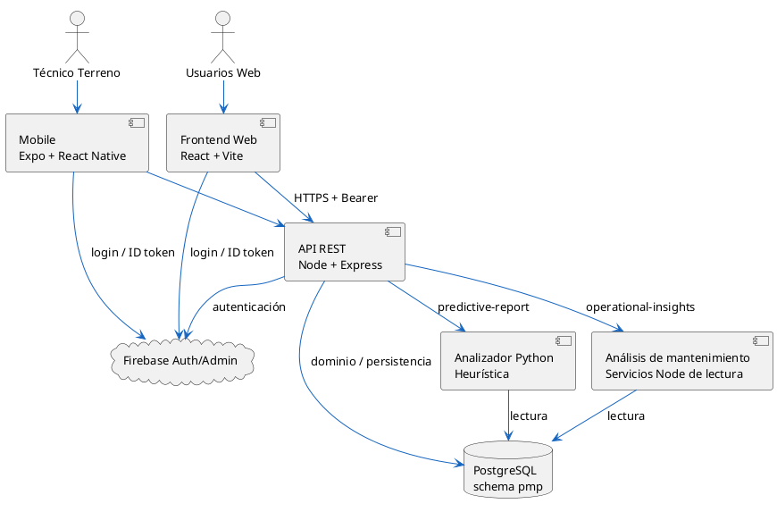
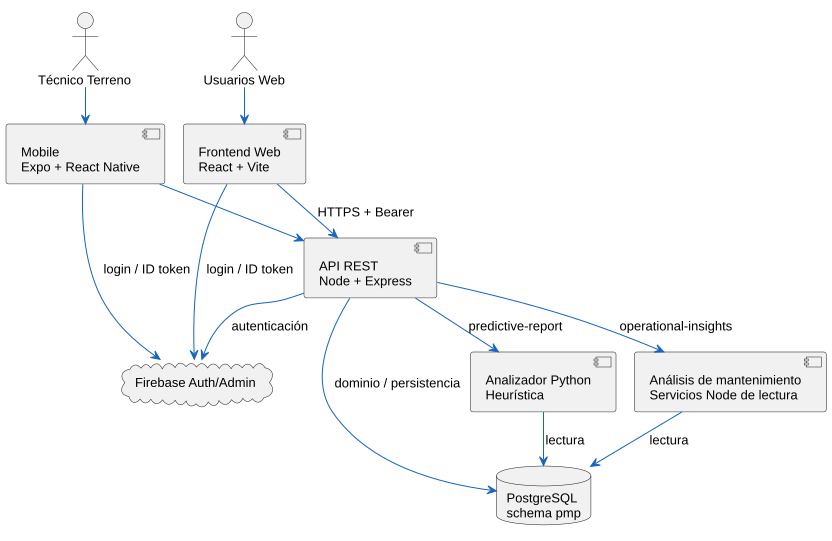

# 02 — Arquitectura lógica

## Diagrama renderizado

[Fuente PlantUML](02_Arquitectura_Logica_V2.0.puml) · [Abrir SVG](02_Arquitectura_Logica_V2.0.svg).

Actualización documental V2.0 del 13-10-2026. Fuente editable y SVG concordantes; no acredita aprobación de fase ni ejecución operacional.
