# BPMN TO-BE — PMP Suite V2.0

**Versión:** V2.0

## 1. Objetivo

Representar el proceso integrado objetivo soportado por PMP Suite, desde falla/retiro hasta reparación, QA, retorno a Bodega y nueva instalación, aplicando Physical First.

## 2. Pool y lanes

**Pool conceptual:** Proceso integrado PMP Suite.

1. Técnico Terreno.
2. Logística / Bodega.
3. Jefe Laboratorio.
4. Técnico Laboratorio.
5. QA.
6. Sistema PMP Suite.

Admin y Gerencia son observadores/autorizados de consulta; no constituyen una lane operacional porque no ejecutan movimientos físicos.

El archivo `BPMN_TO_BE_V2.0.bpmn` contiene las mismas seis lanes.

## 3. Flujo principal

1. Técnico Terreno reporta falla.
2. PMP crea caso/OS y conserva identidad del activo.
3. Terreno valida y confirma retiro físico.
4. PMP registra tránsito a Bodega.
5. Logística valida y confirma recepción.
6. PMP registra custodia Bodega.
7. Logística valida y confirma salida a Laboratorio.
8. PMP abre ciclo Lab.
9. Jefe Lab confirma recepción; PMP inicia SLA.
10. Jefe Lab asigna técnico.
11. Técnico diagnostica.
12. Si requiere repuesto PoD, solicita necesidad; Logística selecciona/entrega y PMP descuenta stock al confirmar entrega.
13. Técnico repara/interviene.
14. Ejecuta pruebas Manual/Test MK.
15. Si la prueba falla vuelve a reparación; si aprueba finaliza trabajo.
16. PMP marca el equipo listo para salida.
17. Jefe Lab valida y confirma salida.
18. Bodega recibe y luego despacha a QA.
19. PMP abre ciclo QA.
20. QA confirma recepción, registra Instalación Ambiente, pruebas y dictamen.
21. Si rechaza: QA sale, Bodega recibe y genera nuevo ciclo Bodega→Lab.
22. Si queda Operativo: QA sale, Bodega recibe y PMP evalúa elegibilidad.
23. Logística valida y confirma despacho a Terreno.
24. PMP crea la IN y SALIDA_BODEGA_TERRENO atómicamente.
25. Terreno confirma el resultado de la instalación.
26. Si resulta operativa, PMP registra INSTALACION_COMPLETADA y estado 13. Si falla, registra INSTALACION_FALLIDA y estado 11; el retorno a Bodega sigue pendiente de su confirmación física.

## 4. Gateways y reglas

| Gateway | Regla |
|---|---|
| ¿Requiere repuesto? | técnico describe necesidad; no administra inventario |
| ¿Pruebas Lab aprobadas? | cierre solo con pruebas válidas |
| ¿QA operativo? | rechazo inicia nuevo ciclo físico; operativo sigue a stock |
| Elegibilidad | Bodega + origen de stock vigente + sin intervención incompatible |
| ¿Instalado OK? | éxito cierra la instalación; falla registra el resultado y exige continuar el retorno físico |

### Physical First

Validar identidad/contexto **no** mueve custodia. Cada entrada y salida requiere confirmación propia.

### Evidencia por movimiento

La evidencia de recepción no sirve para salida; la de un ciclo anterior no sirve para el siguiente.

### Roles

- Logística: Bodega, stock, repuestos y movimientos.
- Jefe Lab: custodia/asignación/supervisión Lab.
- Técnico Lab: trabajo técnico de su carga.
- QA: operación autónoma QA.
- Terreno: retiro/instalación propia.
- Admin/Gerencia: consulta/supervisión según RBAC, sin ejecutar custodia.

## 5. Eventos/efectos de sistema relevantes

- REQUERIMIENTO_INGRESADO.
- RETIRO_TERRENO_CONFIRMADO.
- SALIDA_BODEGA_LABORATORIO.
- RECEPCION_LABORATORIO_CONFIRMADA.
- LAB_TRABAJO_INICIADO / avances / diagnóstico / finalización.
- LOGISTICA_ENTREGA_REPUESTO.
- SALIDA_LABORATORIO_BODEGA.
- ciclo QA + dictamen + salida.
- SALIDA_BODEGA_TERRENO.
- INSTALACION_COMPLETADA.
- INSTALACION_FALLIDA.

## 6. Mejoras respecto del AS-IS

| AS-IS | TO-BE |
|---|---|
| planillas separadas | PostgreSQL + read models centralizados |
| conciliación manual de identidad | tipo+serie y resolución de identificador |
| tránsito/recepción ambiguos | validación + confirmación por movimiento |
| asignación informal | Jefe Lab + carga por técnico |
| inventario mezclado con reparación | Bodega administra stock |
| QA y despacho acoplados | dictamen y salida separados |
| reingreso sin ciclo explícito | nuevo ciclo físico con evidencia nueva |
| consulta por correo | trazabilidad, búsqueda y dashboards |
| historial reconstruido manualmente | eventos + historial por activo |
| instalación anticipada | IN creada solo al confirmar despacho |

## 7. Diagrama de lectura rápida

```mermaid
flowchart TB
 R["Requerimiento sobre activo instalado"] --> OS["Caso + OS; pendiente de retiro"]
 OS --> A["Logística asigna retiro"] --> T["Terreno valida y confirma retiro"]
 T --> BT["En tránsito hacia Bodega"] --> B["Bodega valida y confirma recepción"]
 B --> BL["Bodega valida y confirma salida Lab"] --> TR["En tránsito; sin carga ni SLA Lab"]
 TR --> LR["Jefe Lab valida y confirma recepción"] --> SLA["Ingreso real + SLA del ciclo"]
 SLA --> AS["Jefe Lab asigna técnico"] --> L["Técnico registra diagnóstico"]
 L --> RP{"¿Requiere repuesto PoD?"}
 RP -- "Sí" --> SR["Técnico solicita necesidad de repuesto"]
 SR --> ER["Logística selecciona y confirma entrega; PMP descuenta stock"]
 ER --> RE["Técnico repara o interviene"]
 RP -- "No" --> RE
 RE --> PR["Pruebas Manual / Test MK"] --> PA{"¿Pruebas aprobadas?"}
 PA -- "No" --> RE
 PA -- "Sí" --> C["Cierre técnico; equipo listo para salida"]
 C --> LS["Jefe Lab valida y confirma salida Bodega"]
 LS --> BR["Bodega valida y confirma recepción"]
 BR --> BQ["Bodega valida y confirma salida QA; PMP abre ciclo QA"]
 BQ --> QR["QA confirma recepción"] --> AM["QA registra Instalación Ambiente"]
 AM --> Q["QA registra pruebas y dictamen"]
 Q --> QS["QA valida y confirma salida Bodega"] --> QB["Bodega valida y confirma recepción"]
 QB --> G{"¿Dictamen operativo?"}
 G -- "No: rechazado" --> BL
 G -- "Sí" --> E["Evaluar disponibilidad"]
 E --> D["Logística valida y confirma despacho; PMP crea IN independiente y salida atómicamente"]
 D --> IT["Terreno confirma resultado"] --> GI{"¿Instalado OK?"}
 GI -- "Sí" --> OP["Activo en operación; estado 13"]
 GI -- "No" --> IF["Instalación fallida; estado 11; retorno Bodega pendiente"]
```

## 8. Supervisión

Admin y Gerencia consultan dashboards, OS, trazabilidad y reportes autorizados sin alterar el flujo.

La salida QA y la recepción Bodega son obligatorias tanto para resultado operativo como rechazado. El diagrama BPMN editable representa esa convergencia antes de evaluar el destino. El alta/stock nuevo constituye una entrada alternativa sin mantenimiento; se detalla en el diagrama 10 del índice de diagramas.

## Lectura por tramos

Estas vistas amplían el mismo SVG BPMN; no son procesos nuevos. Las flechas que cruzan el borde continúan en el tramo contiguo o en el retorno indicado. Orden vertical de lanes: Terreno, Logística, Jefe Lab, Técnico Lab, QA y Sistema.

- [Retiro y recepción en Bodega](BPMN_TO_BE_Detalle_01_Retiro_Bodega.svg).
- [Ingreso y trabajo de Laboratorio](BPMN_TO_BE_Detalle_02_Trabajo_Laboratorio.svg).
- [Salida de Laboratorio y circuito QA](BPMN_TO_BE_Detalle_03_Custodia_QA.svg).
- [Disponibilidad, instalación o reingreso](BPMN_TO_BE_Detalle_04_Instalacion_Reingreso.svg).

[Ver proceso completo](BPMN_TO_BE_V2.0.svg) · [Abrir fuente BPMN 2.0](BPMN_TO_BE_V2.0.bpmn).
