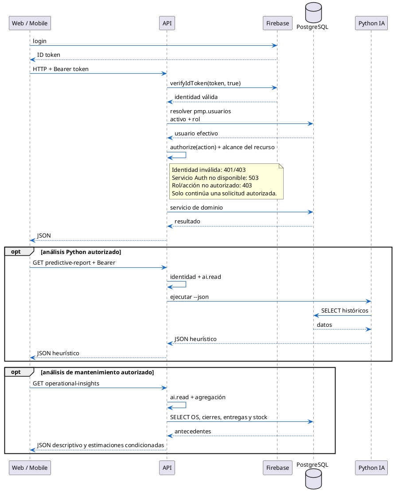
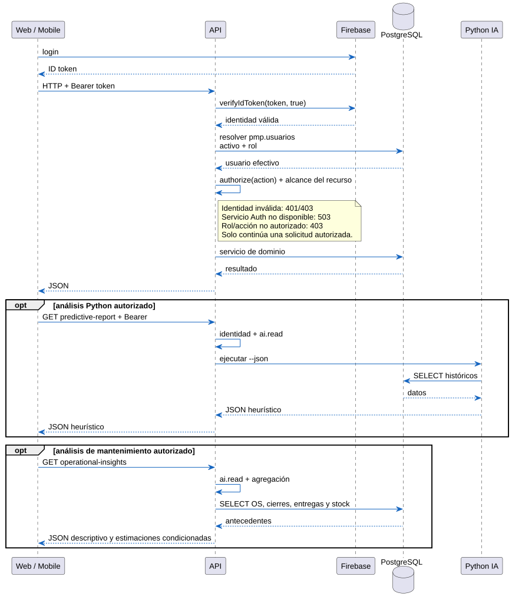

# 04 — Comunicación entre servicios

## Diagrama renderizado

[Fuente PlantUML](04_Comunicacion_Entre_Servicios_V2.0.puml) · [Abrir SVG](04_Comunicacion_Entre_Servicios_V2.0.svg).

Actualización documental V2.0 del 13-10-2026. Fuente editable y SVG concordantes; no acredita aprobación de fase ni ejecución operacional.
