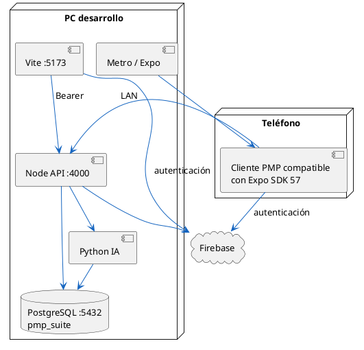
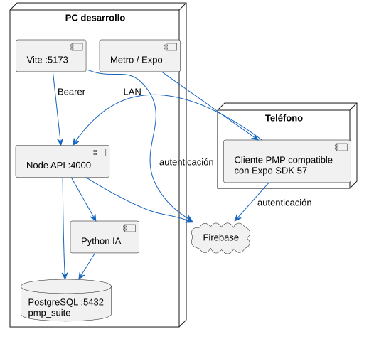

# 09 — Ejecución local

## Diagrama renderizado

[Fuente PlantUML](09_Ejecucion_Local_V2.0.puml) · [Abrir SVG](09_Ejecucion_Local_V2.0.svg).

Actualización documental V2.0 del 13-10-2026. Fuente editable y SVG concordantes; no acredita aprobación de fase ni ejecución operacional.
