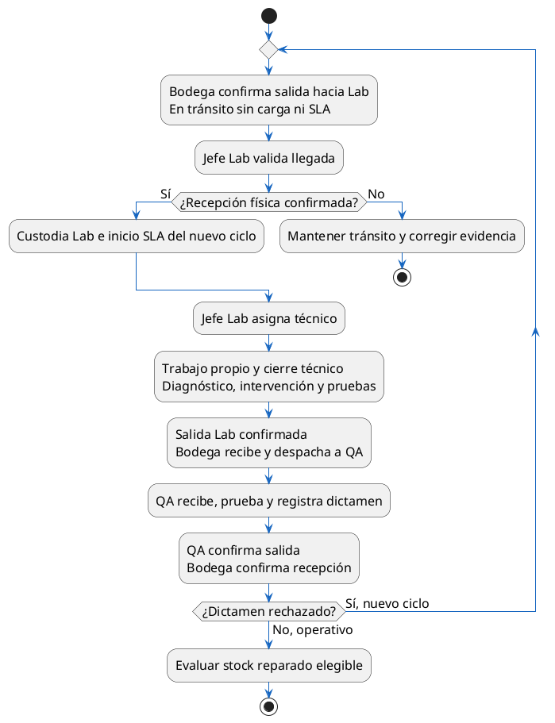
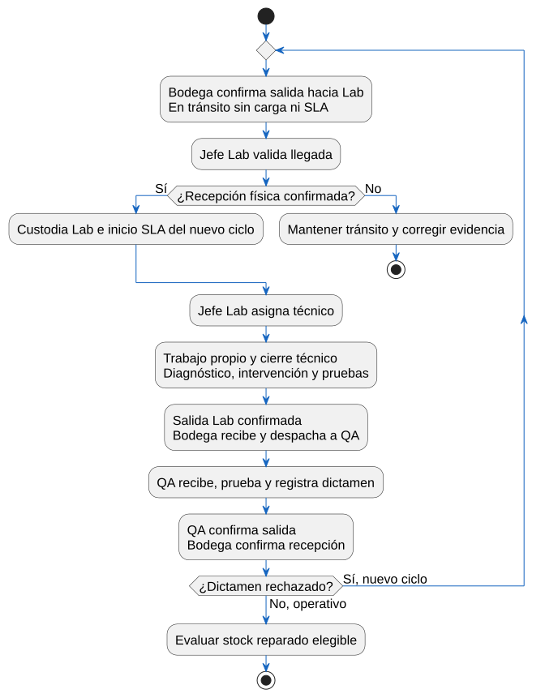

# Recepción, carga y SLA de Laboratorio

**Revisión documental:** 13-10-2026. Diagrama funcional; no agrega estados a la FSM.

## Diagrama renderizado

[Fuente PlantUML](11_Ciclo_Laboratorio_SLA_V2.0.puml) — [Abrir SVG](11_Ciclo_Laboratorio_SLA_V2.0.svg).

Actualización documental V2.0 del 13-10-2026. Fuente editable y SVG concordantes; no acredita aprobación de fase ni ejecución operacional.
